# Oriel

*[Version française](README.fr.md)*

**Oriel is an open-source, self-hosted collaborative workspace.** Write pages made of blocks,
organize them in a tree, build databases whose rows are pages, and edit together in real time.
It runs on your own server (a small VPS is enough) and as a macOS application, with an optional
local mode that works without any server.

The interface is in French. Oriel is licensed under the [GNU AGPL-3.0 or later](LICENSE).

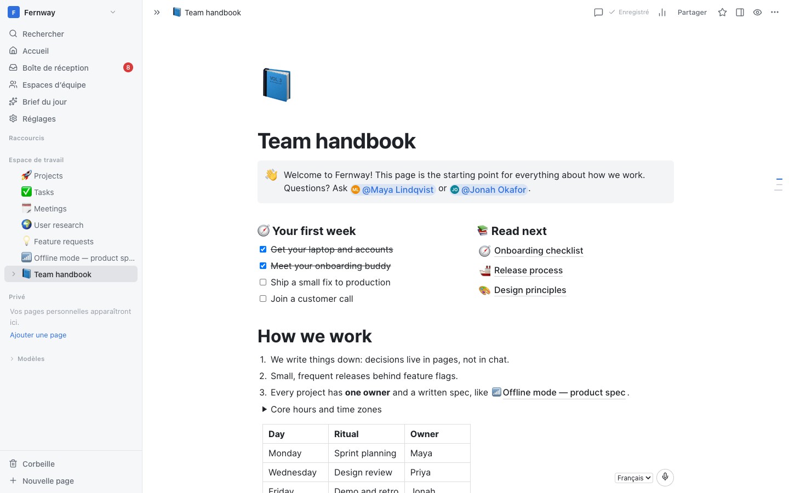

## Features

- **Pages and blocks**: headings, lists, to-dos, toggles, callouts, quotes, code with syntax
  highlighting, tables, columns, tabs, equations, images, videos, files, embeds, bookmarks, table of
  contents, synced blocks, buttons; `/` menu, Markdown shortcuts, drag and drop, mentions of pages,
  people and dates.
- **Real-time collaboration**: conflict-free merging (Yjs CRDT), presence and cursors, offline copy
  in the browser.
- **Databases where every row is a page**: more than 20 property types (select, status, date,
  person, relation, rollup, formula, unique ID, place, files…), filters, sorts, grouping and
  calculations.
- **Views**: table, board, list, gallery, calendar, timeline, feed, charts (bars, lines, donut,
  number), dashboard, map and form (shareable publicly).
- **Comments and mentions**, an inbox, and e-mail notifications (immediate or daily digest).
- **Version history** with block-level comparison and selective restore, trash (30 days).
- **Search** across titles and contents, quick switcher, favorites, teamspaces, private pages.
- **Reading tools**: presentation mode, focus mode, find in page.
- **Teams and security**: workspaces, roles, invitation links, two-factor authentication (TOTP)
  and passkeys, policies requiring two-factor authentication, single sign-on (OpenID Connect),
  verified domains.
- **Sharing and import/export**: public pages, Markdown and HTML export, import of Markdown and CSV
  exports from other tools, Word and Excel files.
- **macOS app**: connects to your server with tabs, a global quick search and a Dock badge, or runs
  in local mode.
- **Claude integration (MCP)**: personal API tokens and an MCP server so that Claude Desktop or
  Claude Code can read, write and query your pages with your permissions; optional AI daily brief.

## Screenshots

| | |
|---|---|
| 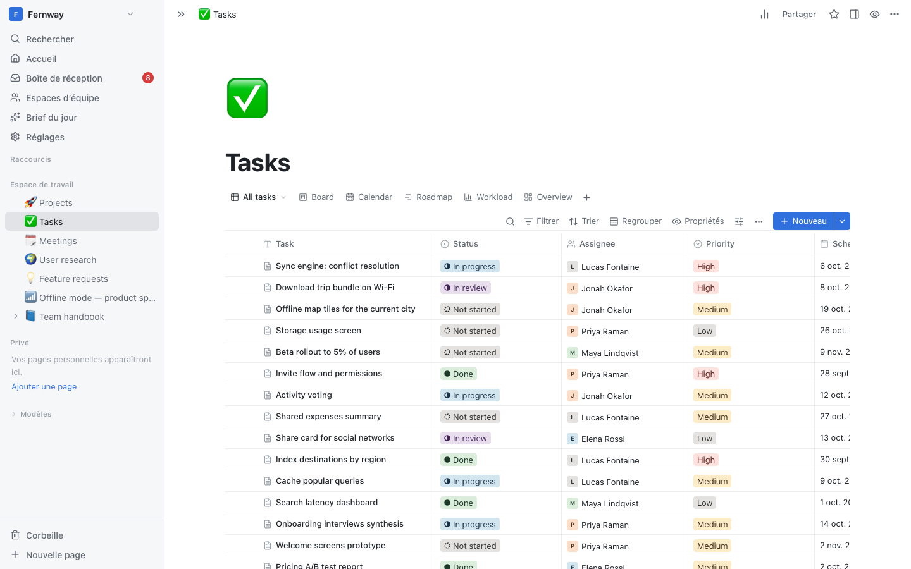 Table | 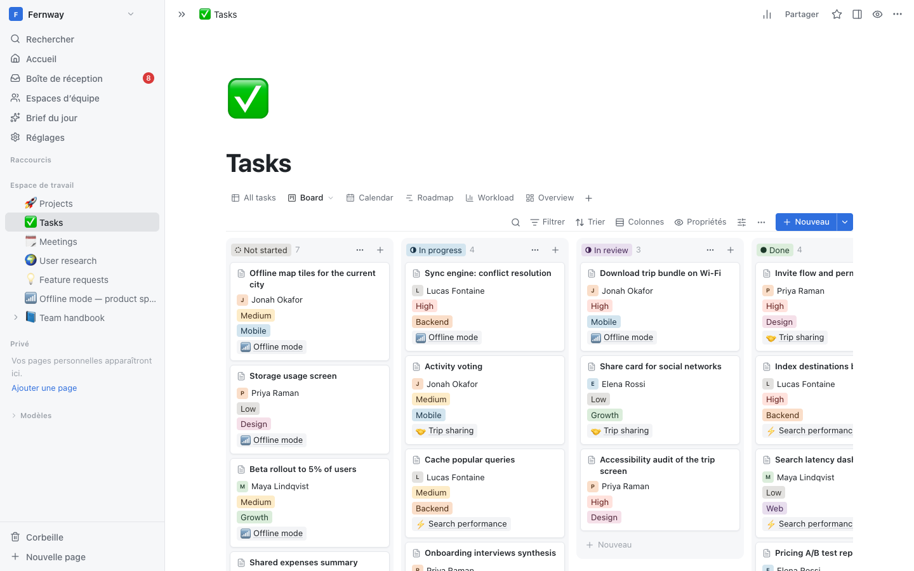 Board |
|  Calendar | 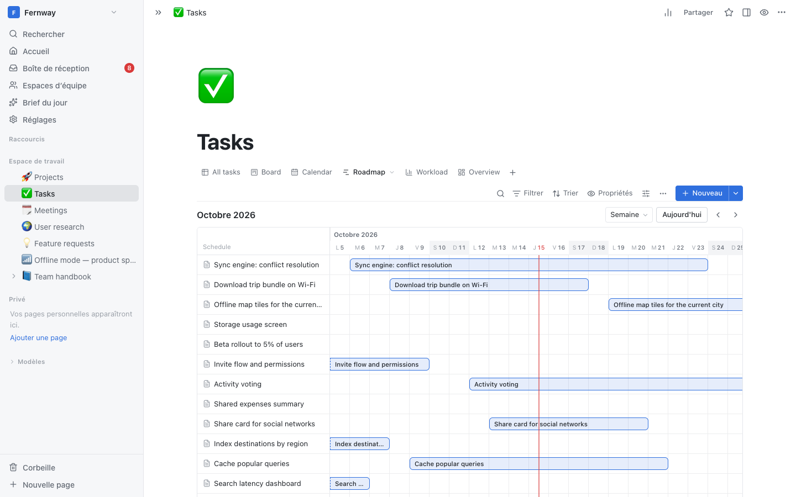 Timeline |
| 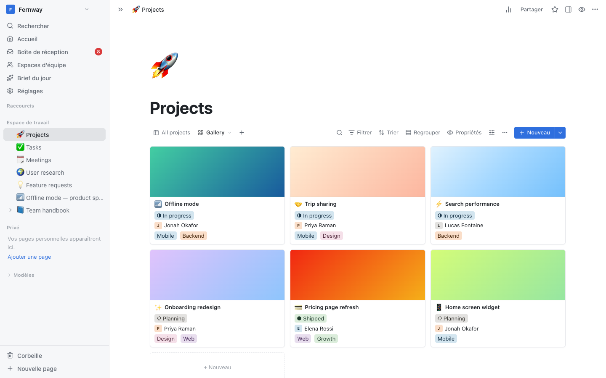 Gallery | 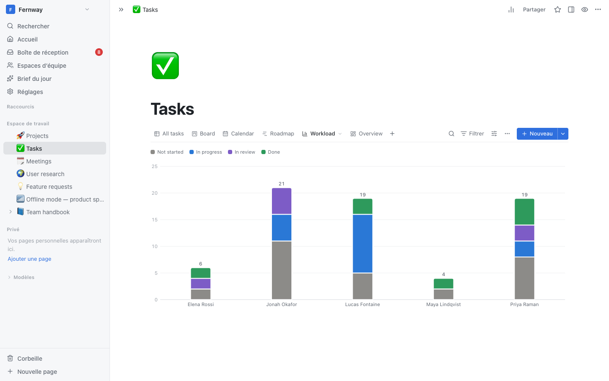 Chart |
| 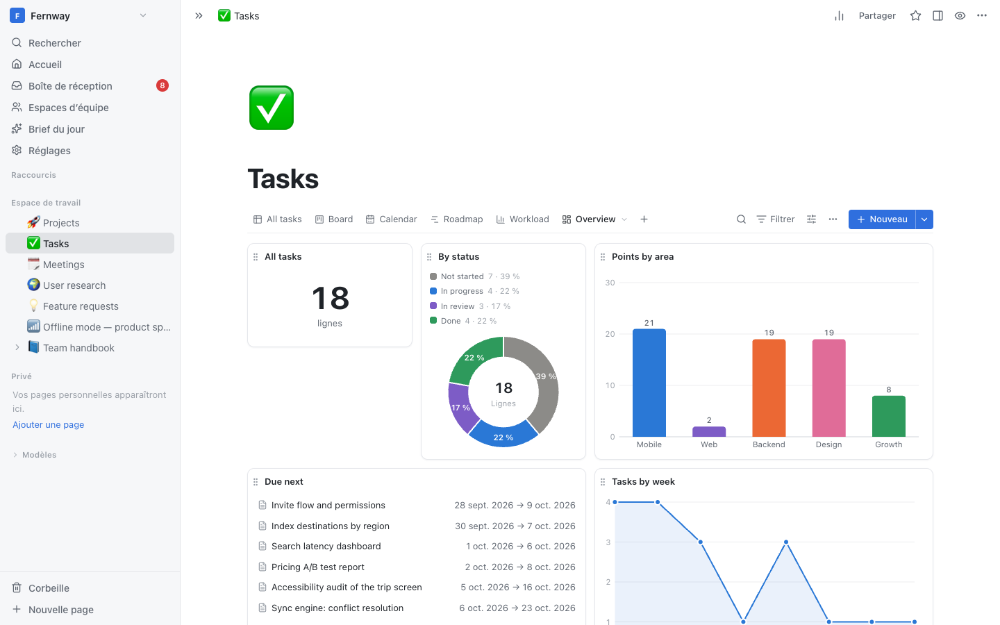 Dashboard |  Map |
| 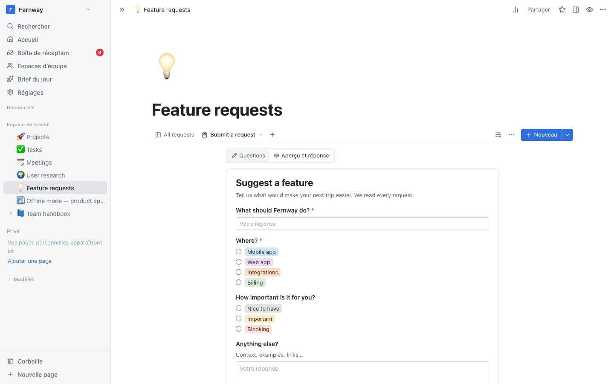 Form | 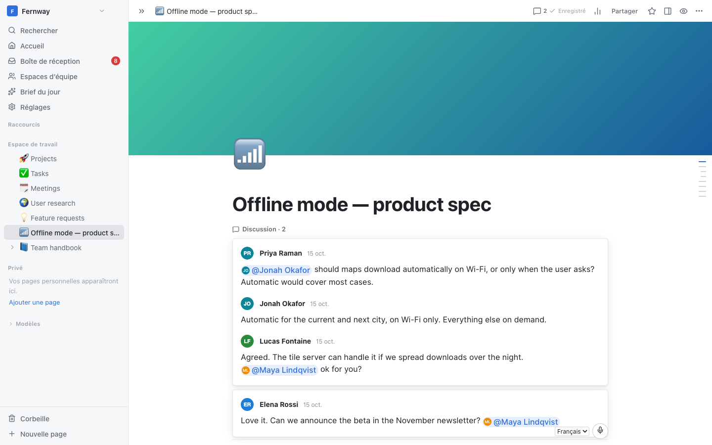 Comments and mentions |
| 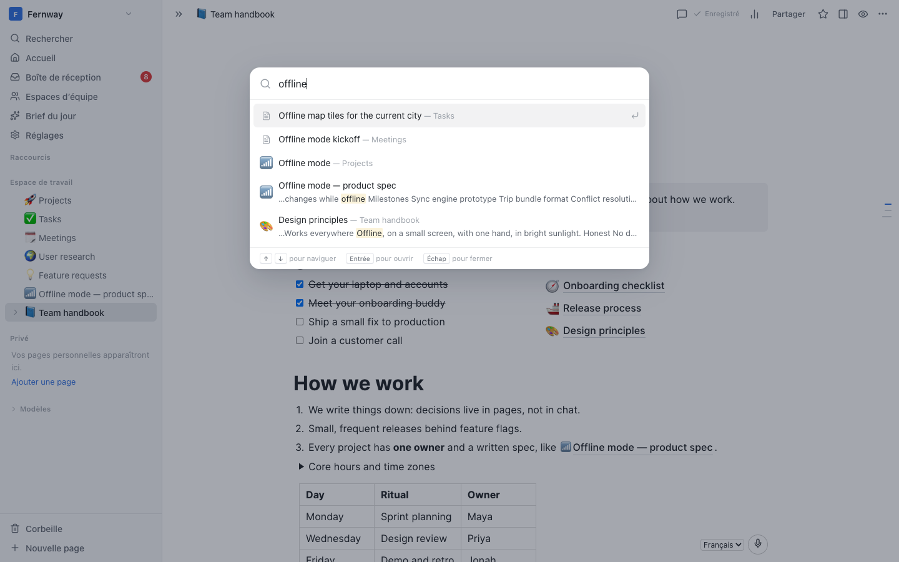 Search | 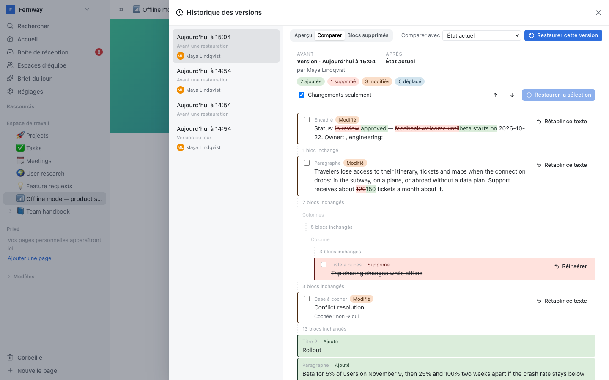 Version history with comparison |
| 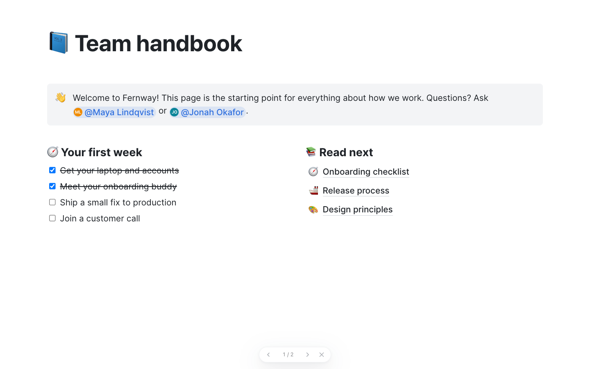 Presentation mode | 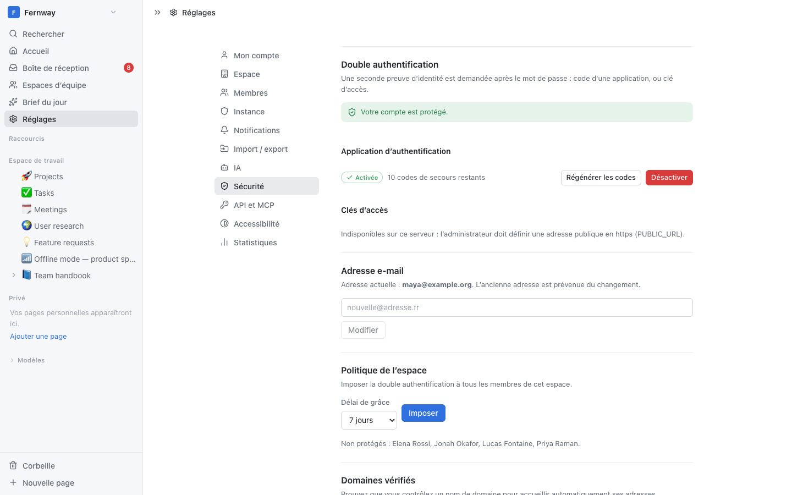 Two-factor authentication |
| 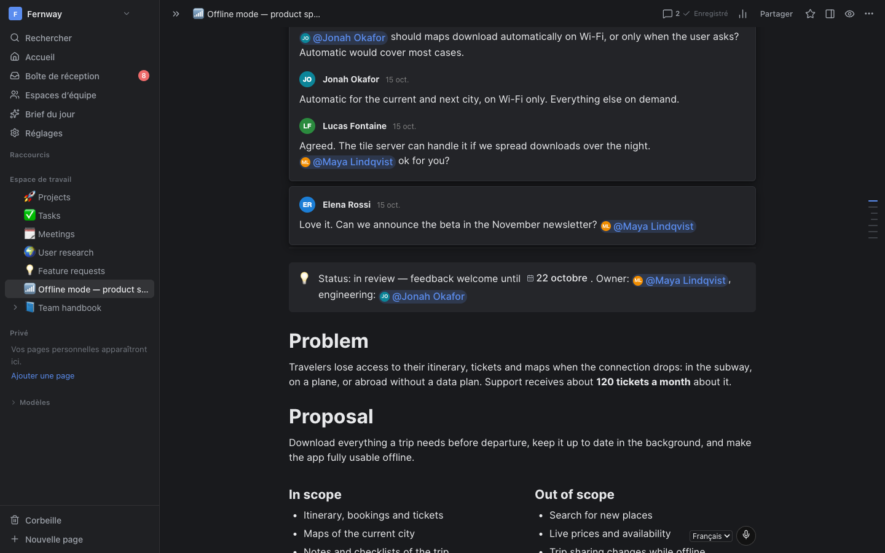 Dark theme | 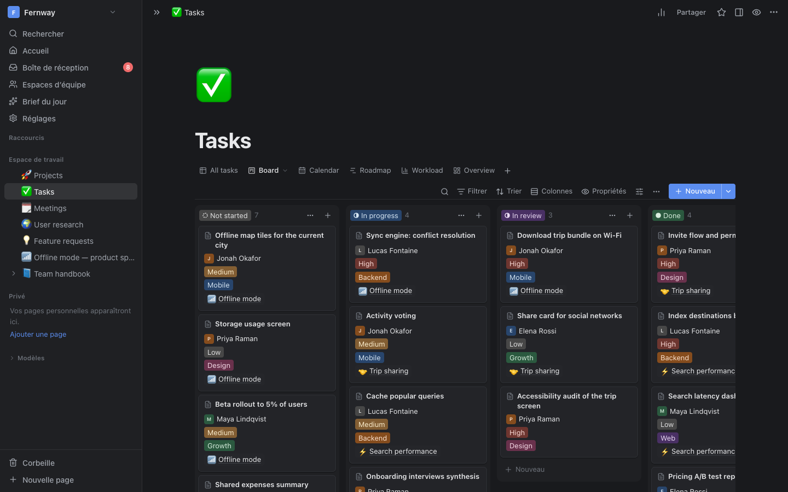 Dark theme |
| 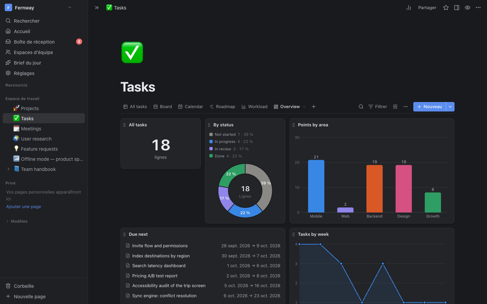 Dark theme | |

The screenshots show a fictional demo workspace.

## Quick start

On a Debian or Ubuntu server whose domain name already points to it:

```bash
git clone <repository-url> oriel && cd oriel
sudo ./deploy/install.sh
```

The script installs Docker, asks for the domain and an e-mail for the HTTPS certificate (Caddy and
Let's Encrypt), then starts Oriel. Open `https://your-domain`: **the first account created becomes
the administrator**; other people join through invitation links.

To try it locally (Node.js ≥ 22.13):

```bash
npm ci
npm run build
PORT=3000 HOST=127.0.0.1 DATA_DIR=$(mktemp -d) node server/dist/server.cjs
```

then open `http://127.0.0.1:3000`.

## Documentation

| Guide | Content |
|---|---|
| [Installation](docs/INSTALL.md) ([français](docs/INSTALL.fr.md)) | Docker and Caddy, nginx and systemd, macOS app, development, environment variables, SMTP, AI, maps, SSO, two-factor authentication, backups, updates, MCP, troubleshooting |
| [DEPLOY.md](docs/DEPLOY.md) | Server deployment details (French) |
| [DESKTOP.md](docs/DESKTOP.md) | macOS application (French) |
| [MCP.md](docs/MCP.md) | MCP server for Claude (French) |
| [ARCHITECTURE.md](docs/ARCHITECTURE.md), [SPEC.md](docs/SPEC.md) | Architecture and functional specification (French) |

## Development

```bash
npm ci
npm run dev            # API on 127.0.0.1:3001 + web client on http://localhost:5173
npm test -w server     # server tests
npm run build          # web/dist + server/dist/server.cjs
```

| Folder | Content |
|---|---|
| `shared/` | TypeScript contract shared by all packages |
| `server/` | Fastify, SQLite (`node:sqlite`, FTS5), Hocuspocus (Yjs) |
| `web/` | React 19, Mantine, TanStack Query, BlockNote editor |
| `desktop/` | Electron app for macOS |
| `mcp/` | MCP server |
| `deploy/` | Docker Compose, Caddy, install, backup and restore scripts |

## Clean-room implementation

Oriel is an independent implementation written from functional descriptions, following a clean-room
procedure described in [CLEAN_ROOM.md](CLEAN_ROOM.md). It is not affiliated with or endorsed by any
other software publisher.

## License

[GNU AGPL-3.0 or later](LICENSE). You may use, modify and redistribute Oriel; if you offer a
modified version to other people over a network, you must give them access to its source code.
Dependencies use free licenses (MIT, MPL-2.0 for BlockNote, GPL-3.0 for its column and export
modules).
